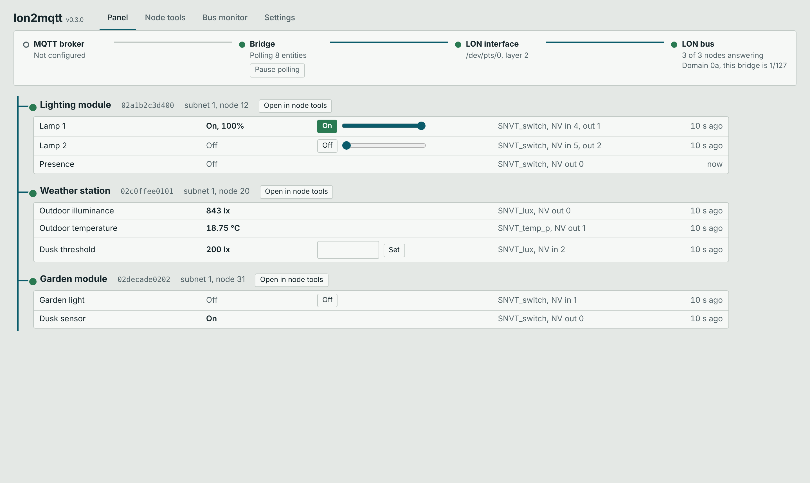
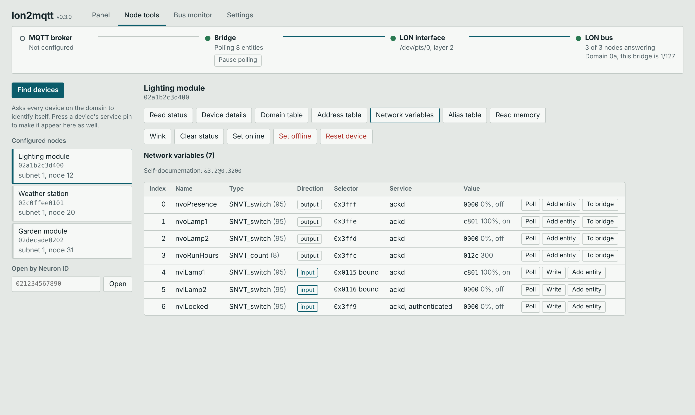
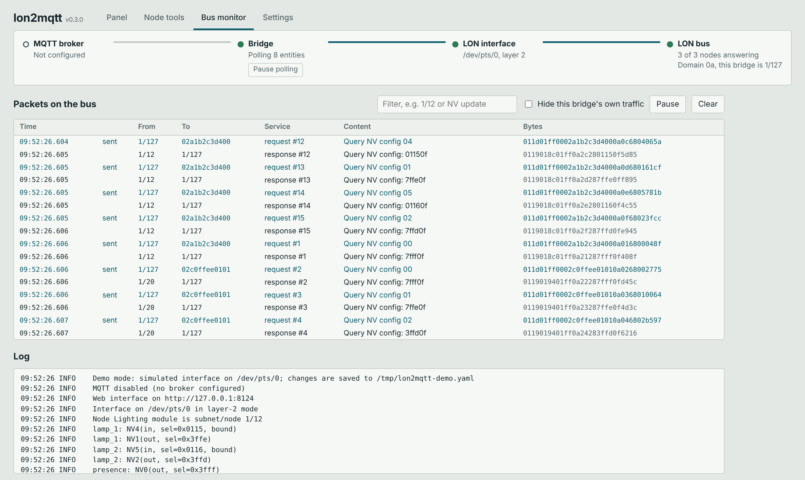
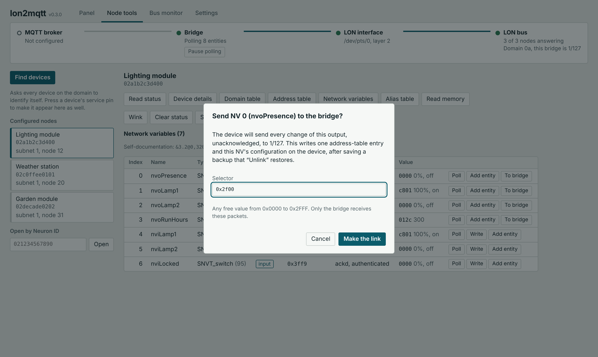

# lon2mqtt

A bridge between a **LonWorks (ISO/IEC 14908, LonTalk)** network and **MQTT**, with
**Home Assistant discovery**, a **web interface** and **NodeUtil-style diagnostics**.

It talks directly to an EnOcean/Echelon USB network interface running **MIP/U61 firmware**
(for example the **U10 FT rev B**) through its FTDI serial port. No kernel driver, no `lonifd`
daemon, no LON network interface and no LNS/OpenLNS license are needed. It runs in an
unprivileged LXC container or on a Raspberry Pi, as long as `/dev/ttyUSB0` is available.

> Status: early. The bridge (read, write, polling, listening) and the binding tool have been
> used with a U10 FT rev B on a residential FT-10 network of dimmer, I/O and sensor modules.
> Everything is also tested against a simulator built from the open-source LON stack's message
> formats. The software sends real network-management messages and can change device
> configuration when you ask it to: use it at your own risk.



## What is in the box

| File | What it does |
|---|---|
| `lon2mqtt.py` | The core: serial link, LonTalk packets, SNVT codecs, the MQTT bridge. Runs on its own as a headless service and has a small CLI (`scan`, `read`, `write`, `sniff`). |
| `lonutil.py` | Node diagnostics as a library and CLI: find devices, service-pin listener, status, device details, domain / address / NV / alias tables, self-identification data, read memory, wink, online / offline / reset, and `bind` / `unbind` (see [Making devices report to the bridge](#making-devices-report-to-the-bridge)). |
| `lonweb.py` + `web/index.html` | Web interface. Runs the bridge and adds a panel, the configuration editor, the diagnostics and a bus monitor. Standard library only. |
| `lonsim.py` | A simulated interface with a few devices, for the tests and for `lonweb.py --demo`. |

`lonutil.py` and `lonweb.py` import `lon2mqtt.py`; nothing else is required beyond
`pyyaml` and `paho-mqtt`.

## Features

- Reads network variables with the network-management **NV Fetch** service (no bindings needed).
- Writes network variables with an **acknowledged explicit NV update**, using the selector
  reported by the node itself (**Query NV Config**), so it works for bound and unbound inputs.
- Per-entity polling intervals, plus **event-driven refresh**: the interface runs in layer 2, so
  when a bound NV update (e.g. a wall switch talking to a dimmer) is seen on the bus, the
  affected entity is re-read immediately.
- **Listen-only entities**: a `listen_selector` entity decodes the NV updates it sees on the
  bus (selector + sender) and publishes them at once, without sending anything to the
  network. Useful for events (a PIR that only sends "on": add `off_delay`), for outputs that
  are already bound to another device, and for devices that do not cope well with being polled.
- **Bind an output to the bridge** (`lonutil.py bind`, or "To bridge" / "Move to bridge" in
  the web NV table): the device then sends every change of that output to the bridge, so it
  no longer has to be polled. A backup is saved first and "Unlink" / `unbind` restores it.
  No LNS database, LonMaker or other installation tool is needed.
- Only one program can own the interface: a second `lon2mqtt`/`lonweb`/`lonutil` gets a clear
  error instead of stealing responses. Responses are matched by transaction, response code,
  sender and NV index, so other tools on the same network cannot confuse the bridge.
- A device that stops answering is backed off (5 s, 10 s … 60 s) so it cannot delay commands
  and the polling of other devices.
- Home Assistant entities: `light` (dimmable or on/off), `switch`, `binary_sensor`, `sensor`,
  `number`. Availability (LWT) and HA birth-message handling included.
- SNVT codecs: `SNVT_switch`, `SNVT_lux`, `SNVT_temp_p`, `SNVT_temp`, `SNVT_lev_percent`,
  `SNVT_lev_cont`, `SNVT_count`, `SNVT_power`, `SNVT_elec_kwh`, `SNVT_press_p`, `SNVT_speed`,
  `SNVT_occupancy`, and `raw` (hex) for anything else.

## Try it without hardware

```bash
pip install -r requirements.txt
python3 lonweb.py --demo
```

Open <http://127.0.0.1:8099>. The demo runs against simulated devices; what you save goes to
a file in the temporary directory.

## Installation

```bash
git clone https://github.com/<you>/lon2mqtt.git
cd lon2mqtt
pip install -r requirements.txt      # pyyaml, paho-mqtt
cp config.example.yaml config.yaml   # or start empty and fill it in from the web interface
```

The kernel's `ftdi_sio` driver exposes the interface as `/dev/ttyUSBx` (USB ID `0920:7500`).
Do **not** load the EnOcean `u61.ko` line discipline: it takes over the port.

The user running the bridge needs access to the serial port (`root`, or membership in the
`dialout` group). Only one process can own the port (it is locked): run **either** `lon2mqtt.py` **or**
`lonweb.py`, not both, and stop them before using `lonutil.py` from the command line.

### Proxmox LXC

Add to `/etc/pve/lxc/<CTID>.conf` on the host (or use `dev0: /dev/ttyUSB0` on PVE ≥ 8.2):

```
lxc.cgroup2.devices.allow: c 188:* rwm
lxc.mount.entry: /dev/ttyUSB0 dev/ttyUSB0 none bind,optional,create=file
```

## Running

```bash
python3 lonweb.py -c config.yaml --host 0.0.0.0     # bridge + web interface
python3 lon2mqtt.py -c config.yaml                  # bridge only, no web interface
```

`lonweb.py` listens on `127.0.0.1:8099` unless `web.host` / `--host` says otherwise. It can
switch lights and reset devices, so set `web.username` and `web.password` before you open it
to a network. It speaks plain HTTP; put a reverse proxy in front if you need TLS.

A systemd unit:

```ini
[Unit]
Description=LonWorks to MQTT bridge with web interface
After=network-online.target

[Service]
WorkingDirectory=/opt/lon2mqtt
ExecStart=/usr/bin/python3 /opt/lon2mqtt/lonweb.py -c /opt/lon2mqtt/config.yaml
Restart=always

[Install]
WantedBy=multi-user.target
```

## The web interface

**Connection path.** The strip at the top shows the chain from the MQTT broker through the
bridge and the interface to the bus, and marks the link that is broken.

**Panel.** Every configured entity with its current value, how old the reading is, and
controls for lights, switches and numbers. Commands go through the same code path as MQTT
commands.

**Node tools.** The read-mostly part of Echelon's NodeUtil:



| Action | NodeUtil equivalent | Messages used |
|---|---|---|
| Find devices | `F` | Query ID (unconfigured); then Respond to Query on, Query ID (selected) repeated while switching each responder off |
| Service pin list | service-pin messages | listens for APDU `0x7F` |
| Read status / Clear status | `S` | Query Status `0x51`, Clear Status `0x53` |
| Device details | `C`, `B` | Read Memory `0x6D` (read-only and configuration structures) |
| Domain table | `D` | Query Domain `0x6A` |
| Address table | `A` | Query Address `0x67` |
| Network variables | `L`, `N` | Query NV Config `0x68`, NV Fetch `0x73`, self-identification data (Read Memory or Query SNVT `0x72`) |
| Alias table | `I` | Query NV Config beyond the NV count |
| Poll / Write on an NV | `P`, `U` | NV Fetch; acknowledged NV update |
| To bridge / Move to bridge / Unlink on an output | `A`, `N` (edit) | Update Address `0x66`, Update NV Config `0x6B`, read back with `0x67`/`0x68`, then Query Status |
| Read memory | `R` | Read Memory |
| Wink | `W` | Wink `0x70` |
| Set online / offline, Reset | `M` | Set Node Mode `0x6C` |

"Add entity" on a network variable puts it into the configuration editor with its index and
SNVT type filled in.

Apart from the binding actions described below, the tools do **not** write configuration: no
domain or memory writes, no changes to inputs' connections, and no change of the
configured/unconfigured state. Those can take a commissioned network apart, and they belong
in an installation tool.

"Find devices" broadcasts to the whole domain (Query ID, Respond to Query on/off). Every
device has to process it. If you know your devices' Neuron IDs, put them in the configuration
and skip it; on one small device with very small network buffers the broadcasts and long
Neuron-ID-addressed requests have been seen to stop its communication until a power cycle.

**Bus monitor.** Decoded packets as the interface sees them in layer 2, with responses paired
to their requests, plus the log.



**Settings.** Serial port, domain, the bridge's own address, timing, MQTT, web access, nodes
and entities. Saving validates the configuration, keeps the previous file as
`config.yaml.bak`, writes the new one (mode 600) and restarts the bridge. Comments in a
hand-written YAML file are not preserved.

## Configuration

See [`config.example.yaml`](config.example.yaml). The essentials:

- `lonworks.domain_id`: the domain your devices are installed in (hex, 0/1/3/6 bytes).
- `lonworks.source_subnet` / `source_node`: the logical address the bridge uses to send.
  **It must not be used by any other device** on the network. Responses are sent back to it.
- For each node: its 48-bit **Neuron ID** (12 hex digits, in quotes). Subnet/node are discovered.
- For each entity: `nv_in` (the input NV the bridge writes) and/or `nv_out` (the output NV it
  reads), the `snvt_type`, the Home Assistant `type` and the `polling_interval`.

### Listen-only entities

```yaml
nodes:
  - id: living
    neuron_id: "02a1b2c3d400"
    entities:
      - id: living_motion
        type: binary_sensor
        device_class: motion
        snvt_type: SNVT_switch
        listen_selector: 0x0123     # the selector the output uses (see the bus monitor)
        listen_source: 1/12         # optional: default = this node; "any" = any sender
        off_delay: 90               # binary_sensor only: back to OFF 90 s after the last event
```

A listen entity has no `nv_in`/`nv_out` and is never polled. Without `listen_source` it
accepts updates from its own node, whose subnet/node the bridge learns from the first
response of any polled entity of that node (or set `subnet:`/`node:` on the node). After a
restart its state is unknown until the next update arrives.

A typical LonWorks dimmer exposes an input (`nviSwitch`) that you write and an output
(`nvoSwitch`) that reports the actual level. Both are `SNVT_switch` (value 0–100 % and state).
Map them to one `light` entity with `nv_in` and `nv_out`.

## Making devices report to the bridge

Polling works with every device, but it is slow to notice changes (a wall switch, a motion
sensor) and keeps the bus busy. LonWorks devices can instead *send* an output NV to whoever
it is bound to, whenever its value changes. The bridge can use that in three ways, from
least to most invasive:

| | When | What is written on the device |
|---|---|---|
| **Listen** | the output is already bound to some other device | nothing |
| **To bridge** | the output is not bound (selector `0x3Fxx`, no address entry) | one address-table entry and the NV's configuration |
| **Move to bridge** | the output is bound, but you need it on its own selector (two outputs share one, so they cannot be told apart) | same as above; the previous destination stops receiving it |

### 1. Listen to what is already on the bus

The interface runs in layer 2 and sees every packet on the channel, not only those addressed
to the bridge. Open the **Bus monitor**, make the device act (walk past the sensor, press the
switch) and note the line `NV update, selector 0x…` and its sender (`1/12`). In **Node tools →
Network variables** the same selector appears on the output, marked *bound*. "Add entity" on
that output offers "Listen to its updates on the bus"; or write it by hand:

```yaml
      - id: hall_motion
        type: binary_sensor
        device_class: motion
        snvt_type: SNVT_switch
        listen_selector: 0x0123
        off_delay: 120          # the sensor only ever sends "on": go back to OFF after 2 min
```

Nothing is sent to the network for a listen entity. Separately, entities that poll a *bound*
NV (an input fed by a wall switch, an output sent to another device) are re-read 0.3 s after
the bridge sees an update with that selector, whatever their `polling_interval`.

### 2. Bind an unbound output to the bridge

In **Node tools → Network variables**, an output that is not bound has a **To bridge**
button. It asks for a selector (default `0x2F00 + NV index`; any value from `0x0000` to
`0x2FFF` that you do not use elsewhere) and then:

1. reads the NV's configuration, the device's domain table and its address table, and saves
   the NV's current configuration and the address entry it is going to use to
   `bindings/<neuron id>-nv<index>-<date>.json` next to the configuration file;
2. picks an address-table entry: one that already points to the bridge, or the first free one
   (it stops if the table is full);
3. writes that entry (subnet/node of the bridge) with **Update Address**, and the NV's new
   selector, service (**unacknowledged** — the bridge hears the packet without having to
   answer it) and address index with **Update NV Config**;
4. reads both back and compares them byte for byte;
5. waits two seconds and checks with **Query Status** that the device is still configured and
   online (a configuration change the firmware did not accept would make it reset into the
   unconfigured state).



The dialog then offers to add a listen entity for the new selector. From the command line:

```bash
python3 lonutil.py -c config.yaml bind <node> 25                 # show the plan, write nothing
python3 lonutil.py -c config.yaml bind <node> 25 --yes           # back up, write, verify
python3 lonutil.py -c config.yaml bind <node> 25 --selector 0x2f40 --yes
```

Outputs that a polled entity already reads (`nv_out`) need no new entity: after a restart the
bridge sees that the NV is bound and re-reads it every time the device sends it, so its
`polling_interval` can be raised to a few minutes as a safety net.

### 3. Move an output that is already bound

Two outputs bound to the same destination often share one selector: the receiver cannot (and
the bridge cannot) tell which one sent an update. **Move to bridge** (`bind --replace`) gives
one of them a selector of its own, addressed to the bridge. The device it was sent to before
stops receiving it; the backup keeps the old selector, service and address index, and
**Unlink** puts them back.

### Undo

**Unlink** in the NV table (or `lonutil.py unbind bindings/<file>.json --yes`) restores the
NV's configuration and, if the bridge's address entry was created for it, that entry. The web
interface then renames the backup file to `.undone`.

### Things to know

- Network configuration (address table, NV configuration) is kept in the device's
  non-volatile memory and survives a power failure, like the connections an installation tool
  makes; check it once by switching one device off and on. NV *values* usually live in RAM:
  an input you enabled from the bridge may be back to its default after a power cut.
- Use the binding tool only on networks that **no LNS/IzoT/LonMaker database manages**. Such a
  database would not know about the change and would undo it, or be confused by it, the next
  time it touches the device.
- Each binding uses one address-table entry per destination (15 at most per device). All the
  outputs of a device that are sent to the bridge share one entry.
- Unacknowledged updates are not repeated: a packet lost to a collision is lost. Keep a slow
  poll as a safety net for states (light levels); events (motion) just arrive late once.
- The bridge does not check selectors across devices. Choose selectors that no input on the
  network uses (the bus monitor and the NV tables show the ones in use). The default
  `0x2F00 + index` gives the same selector to the same NV on identical devices: that is fine
  for listen entities (they also filter on the sender), but for outputs that polled entities
  read, a different selector per device avoids re-reading every device's NV on each update.

## MQTT topics

| Topic | Content |
|---|---|
| `<base>/status` | `online` / `offline` (retained, LWT) |
| `<base>/<entity>/state` | JSON, retained. Always contains `raw` (hex); plus `value`, `state`, `brightness`, `switch_state` depending on type |
| `<base>/<entity>/set` | Commands. Lights: HA JSON schema (`{"state":"ON","brightness":150}`, brightness 0–200 = 0–100 %). Switches: `ON`/`OFF`. Numbers: the value |
| `<prefix>/<component>/<node>/<entity>/config` | Home Assistant discovery (retained) |

## Command line

`<node>` is a node id or name from the configuration, or a 12-digit Neuron ID.

```bash
python3 lon2mqtt.py -c config.yaml scan  <node>
python3 lon2mqtt.py -c config.yaml read  <node> 29 --type SNVT_switch
python3 lon2mqtt.py -c config.yaml write <node> 51 75:on --type SNVT_switch
python3 lon2mqtt.py -c config.yaml sniff

python3 lonutil.py -c config.yaml find
python3 lonutil.py -c config.yaml pins                     # wait for service-pin messages
python3 lonutil.py -c config.yaml status|info|domains|addresses|nvs|aliases <node>
python3 lonutil.py -c config.yaml wink|online|offline|reset|clear <node>
python3 lonutil.py -c config.yaml mem <node> ro 0 41       # abs | ro | cfg | stat
python3 lonutil.py -c config.yaml bind <node> 25            # show the plan, write nothing
python3 lonutil.py -c config.yaml bind <node> 25 --yes      # back up, write, verify
python3 lonutil.py -c config.yaml unbind bindings/<file>.json --yes
```

`bind` and `unbind` are explained in
[Making devices report to the bridge](#making-devices-report-to-the-bridge).

Only one program can use the interface at a time; stop the bridge (or lonweb) before using
the command-line tools, or use the same functions from the web interface.

Add `--json` to `lonutil.py` for machine-readable output.

## How it works

| Layer | Detail |
|---|---|
| Serial | 460800 baud, 8N1, raw, no flow control, DTR/RTS asserted |
| Framing (UMIP) | `7E 00 <len> <ni_cmd> <data…>`, `len` counts `ni_cmd`, `7E` in data doubled, no checksum |
| Start-up | `7E 00 02 E5 01` puts the interface in layer-2 mode (it echoes the mode) |
| Transmit | `ni_cmd 0x12`, data = LPDU header + NPDU; the interface appends the CRC |
| Receive | `ni_cmd 0x1A`, data = LPDU header + NPDU + CRC16 |
| Read | SPDU request `0x73 <nv index>` to the node's Neuron ID → response `0x33 <index> <value>` |
| Write | `0x68` query gives the selector; then ACKD TPDU `[0x80 \| sel_hi][sel_lo][value]` to subnet/node |

Protocol details were taken from EnOcean's open-source
[lon-driver](https://github.com/izot/lon-driver) (`u61/U61Link.c`),
[lon-stack-dx](https://github.com/izot/lon-stack-dx) (`lon_usb/lon_usb_link.c`,
`lcs/lcs_netmgmt.c`, `include/izot/lon_types.h`) and
[lon-stack-ex](https://github.com/izot/lon-stack-ex), and from S. Pastor's `native-linux-u61`
work on running the U61 in user space. This project re-implements the protocol in Python and
contains no code from those repositories. SNVT type names follow the LonMark SNVT Master
List; the interface always shows the numeric index next to the name.

## Supported hardware

| Interface | Firmware | Supported |
|---|---|---|
| U10 FT rev B, U20 PL, U60 TP-1250, U70 PL | MIP/U61 (parallel USB) | yes (U10 FT rev B tested) |
| U10 rev C, U60 FT | MIP/U50 (serial USB, code packets + checksums) | no |

## Tests

```bash
python3 tests/test_all.py
```

The tests run the link, the diagnostics, the bridge and the web API against `lonsim.py` on a
pseudo-terminal. The simulator models message formats, not bus timing: there are no
collisions and no retries in it.

## Limitations

- **LonTalk authentication is not implemented.** Authenticated NVs can be read, but the node
  rejects writes. A device with network-management authentication enabled only answers
  Query ID; the diagnostics show that in "Device details".
- Self-identification data is decoded for versions 0 and 1. The version 1 layout was checked
  against the open-source stacks; the older version 0 header (5 bytes instead of 6) was not,
  so compare the NV names and types of an old device with its documentation once. Version 2
  (devices with many or dynamic NVs) is reported but not decoded.
- Only one interface and one domain per instance. Each instance needs its own MQTT `client_id`.
- Polling uses network-management messages; keep intervals reasonable on busy FT-10 channels
  (each read is a request and a response of about 31 bytes together).
- Event-driven refresh and listen entities only see **bound** NV updates travelling on the
  same channel. The bridge never acknowledges them; a sender using the acknowledged service
  must be acknowledged by its real destination.
- "Find devices" relies on every device answering a domain broadcast. On a large or noisy
  network some responses can collide; run it again, or press the service pin.
- Network-management requests are addressed by Neuron ID. A device with very small network
  buffers may not cope with them; leave such a device out of the configuration and listen to
  what it sends instead.
- The web interface has no user roles and no TLS.

## License

MIT
